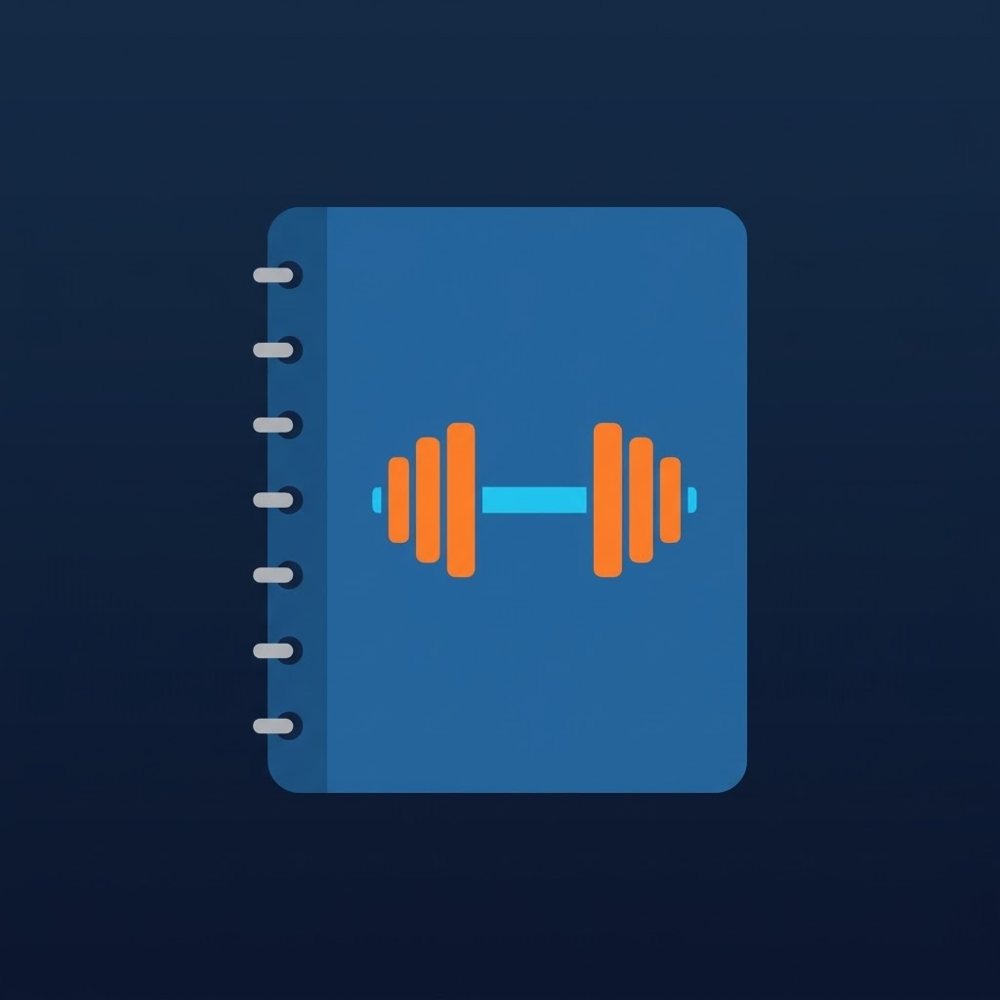

<p align="center">
  
</p>

<h1 align="center">RepFolio</h1>

<p align="center">
  <b>A private, offline gym &amp; running tracker for iPhone – built with SwiftUI, SwiftData and Swift Charts.</b><br>
  Training plans for 2 or 3 gym days a week · a photo of every machine · progress tracking · running log · calorie dashboard.
</p>

<p align="center">
  
  
  
  
  
</p>

> **Kurz auf Deutsch:** IronLog ist eine persönliche Gym-App (UI auf Deutsch). Sie schlägt dir einen Plan für 2× oder 3× Gym pro Woche vor, zeigt zu **jeder Übung Bilder mit dem Gerät**, speichert deine Gewichte und Läufe lokal auf dem iPhone und zeigt ein Dashboard mit geschätztem Kalorienverbrauch. Gebaut für die Installation über Xcode mit kostenlosem Apple-Account – inkl. Erinnerung, bevor die 7-Tage-Signatur abläuft, und automatischen Backups.

---

## Why

I've been going to the gym for years but I'm terrible with exercise and machine names. Most apps show a list of names. RepFolio shows **what the machine looks like and how the movement looks**, right inside the workout. It is built for exactly one user per phone: no account, no server, no tracking. Your data never leaves your iPhone unless you export it.

## Features

### Training
- **Ready-made plans** (machine-friendly, works in almost every commercial gym)
  - **2× / week:** Full body A / B
  - **3× / week:** Upper / Lower / Full body
  - Every muscle is trained ~2× per week in both variants. Switch any time.
- **Rotation logic** – the app knows which workout is next.
- **Fully editable plans** – reorder, add, remove, change sets & rep ranges, **swap an exercise** for a suitable alternative (e.g. the machine is taken).
- **Workout logging** – weight & reps per set (accepts `62,5` and `62.5`), check off sets, add/remove sets, add exercises on the fly. Interrupted workouts are kept and can be resumed.
- **Progression coach** (double progression) – hit the top of your rep range in every set → the app suggests the next weight. Shows "last time" values for every exercise.
- **Personal records** – estimated 1RM (Epley) per set, badge on new records, PR summary after each workout.
- **Rest timer** with ±15 s, haptics and a notification when you're in another app.

### Exercise library (50 curated exercises)
- **Two photos per exercise (start & end position, with the machine)** that cross-fade like a GIF.
- German names + original English name, muscles worked, equipment, 3 short form cues.
- **"Mein Gerät"** – save your machine settings (`Sitz 4 · Lehne 2`) and take **your own photo** of the machine in your gym. It's shown in the workout instead of the stock photo.
- Per-exercise **progress chart** (top weight & estimated 1RM) and history.

### Running
- Log date, distance, duration, type (easy, tempo, intervals, long run, race, treadmill), avg. heart rate, feeling, notes.
- Pace, calorie estimate, weekly km chart, fastest pace (≥ 3 km), longest run, weekly/monthly totals.

### Dashboard
- Weekly goal rings (gym & runs), **streak** of weeks in which you hit your gym goal.
- **Estimated calories per day / week** – stacked chart of base metabolism, gym and running (tap a bar for details).
- Sets per muscle group this week (with the 10–20 sets guideline).
- Body-weight trend, all-time totals (workouts, runs, km, tonnage) and records of the last 30 days.

### Built for free Xcode provisioning
- **Data survives the weekly re-install** (see below).
- **Signature expiry banner + push reminder** 24 h and 3 h before the app stops launching.
- **Automatic JSON backups** (latest + 14 daily files) into the app's `Documents/Backups`, visible in the Files app.
- **Export / import backup** (iCloud Drive, AirDrop, Mac …) and **CSV export** of all sets and runs.

---

## How data is stored (and why it doesn't get lost)

| What | Where | Survives Xcode re-run? |
|---|---|---|
| All data (SwiftData / SQLite) | App container › Application Support | yes – Xcode installs *over* the existing app |
| Auto backups (`IronLog-latest.json`, `IronLog-YYYY-MM-DD.json`) | App container › Documents/Backups (Files app: *Auf meinem iPhone › IronLog*) | yes |
| Exported backup | wherever you put it (iCloud Drive, Mac) | even if the app is deleted |

With a free Apple ID the app's **signature** expires after 7 days – the app then won't open, but **its data stays on the phone**. Plug in the iPhone, press ▶︎ in Xcode, done. You only lose data if you

1. **delete the app** from the iPhone, or
2. **change the bundle identifier** (a new bundle id is a new app with a new, empty container).

So: keep `BUNDLE_ID_PREFIX` the same forever, and export a backup to iCloud Drive every now and then (*Profil › Daten & Backup › Backup exportieren*). If the database is ever empty while an auto-backup exists, RepFolio offers to restore it on launch.

---

## Getting started

### Requirements
- A Mac with **Xcode 16 or newer**
- An iPhone with **iOS 17 or newer**
- A (free) Apple ID added in *Xcode › Settings › Accounts*

### 1. Clone
```bash
git clone https://github.com/<your-user>/RepFolio.git
cd RepFolio
```

### 2. Personal signing config (stays private)
```bash
cp Config/Signing.example.xcconfig Config/Signing.xcconfig
```
Open `Config/Signing.xcconfig` and set:
```
DEVELOPMENT_TEAM = ABCDE12345     // your Personal Team ID
BUNDLE_ID_PREFIX = de.yourname    // anything unique → bundle id de.yourname.RepFolio
```
`Signing.xcconfig` is in `.gitignore`, so your Team ID never ends up on GitHub.

> **Where's my Team ID?** Easiest way: open the project, select the *RepFolio* target › *Signing & Capabilities*, pick your "(Personal Team)", copy the 10-character ID Xcode shows, put it into `Signing.xcconfig`, then set the Team dropdown back to **None**. (Otherwise Xcode writes the ID into `project.pbxproj` – the pre-commit check below catches that.)

### 3. Run on your iPhone
1. Connect the iPhone via cable (first time), unlock it and tap *Trust*.
2. Open `RepFolio.xcodeproj`, select your iPhone as run destination, press **▶︎**.
3. First launch only: on the iPhone open *Settings › General › VPN & Device Management*, trust your developer certificate, and enable *Settings › Privacy & Security › Developer Mode* if asked.
4. Allow notifications – that's how RepFolio reminds you before the signature expires.

### 4. Every week
The app shows a banner and sends a notification ~24 h before expiry → connect iPhone (or use wireless debugging), press **▶︎**. That's it – all your data is still there.

### Optional: privacy pre-commit hook
```bash
ln -sf ../../Scripts/check-private.sh .git/hooks/pre-commit
```
Blocks commits that contain your Team ID in the project file, backups, CSV exports or database files.

---

## Privacy – what is (not) in this repository

The repository contains **only the app**. Everything personal is created at runtime on your device and is never part of the source tree:

- workouts, sets, weights, PRs, runs, body weight, profile (age, height, sex), calorie numbers, machine photos → **on-device SwiftData store**
- backups / CSV exports → **on-device or wherever you export them** (patterns like `RepFolio-*.json`, `*.csv` exports, `*.store`, `*.sqlite` are git-ignored just in case you copy them into the folder)
- Apple Team ID & bundle id → `Config/Signing.xcconfig` (**git-ignored**)

Anyone who clones the repo gets a fresh app with an onboarding screen and empty history.

---

## How the numbers are calculated

All calorie values are **estimates**, not medical measurements.

| Value | Formula |
|---|---|
| Base metabolic rate (BMR) | Mifflin-St Jeor: `10·kg + 6.25·cm − 5·age + 5` (♂) / `− 161` (♀) |
| Daily base | `BMR × everyday activity factor` (1.2 sitting · 1.35 light · 1.5 active) – sport *not* included |
| Gym session | `(MET 5.0 − 1) × kg × hours` (capped at 2.5 h) |
| Run | `(MET(speed) − 1) × kg × hours`, MET interpolated from the *Compendium of Physical Activities* (e.g. 10 km/h ≈ 10 MET) |
| Day total | daily base + gym + runs (the "− 1 MET" avoids counting resting energy twice) |
| Estimated 1RM | Epley: `weight × (1 + reps / 30)` |
| Progression | double progression: all working sets ≥ top of the rep range → + exercise-specific increment (1–5 kg) |

---

## Project structure

```
RepFolio/
├── RepFolio.xcodeproj           # Xcode 16 project (folder-synced: new files are picked up automatically)
├── Config/
│   ├── Base.xcconfig           # bundle id template, includes Signing.xcconfig if present
│   ├── Signing.example.xcconfig
│   └── Info.plist              # Files-app sharing for backups
├── RepFolio/
│   ├── App/                    # App entry, RootView (tabs, onboarding, restore offer)
│   ├── Models/                 # SwiftData models, exercise catalog
│   ├── Services/               # plans, progression, energy, backup, provisioning expiry, rest timer
│   ├── Views/                  # Dashboard, Training, Running, Exercises, Settings, Components
│   ├── Resources/
│   │   ├── exercises.json      # curated catalog (German names & cues)
│   │   └── ExerciseImages/     # 2 photos per exercise
│   └── Assets.xcassets
└── Scripts/
    ├── curate_exercises.py     # rebuilds exercises.json + images from Free Exercise DB
    └── check-private.sh        # pre-commit privacy guard
```

### Adding exercises
1. Find the exercise id on the [Free Exercise DB site](https://yuhonas.github.io/free-exercise-db/).
2. Add it with a German name, group, weight increment and three cues to `CURATED` in `Scripts/curate_exercises.py`.
3. Run
   ```bash
   curl -L -o /tmp/exercises.json https://raw.githubusercontent.com/yuhonas/free-exercise-db/main/dist/exercises.json
   python3 Scripts/curate_exercises.py /tmp/exercises.json RepFolio/Resources
   ```

### Changing the default plans
Edit `RepFolio/Services/PlanTemplates.swift`. Existing installs keep their (possibly edited) plan; use *Profil › Trainingsplan › auf Standard zurücksetzen* to load the new default.

---

## Roadmap ideas
- Apple Health import/export for runs and body weight
- Home-screen widget with the next workout and weekly rings
- Supersets and warm-up set calculator
- Plate calculator for barbell exercises

Pull requests welcome.

## Credits
- Exercise photos and English instructions: **[Free Exercise DB](https://github.com/yuhonas/free-exercise-db)** by yuhonas – public domain ([The Unlicense](https://unlicense.org/)). German names and cues written for this project.
- MET values: Ainsworth et al., *Compendium of Physical Activities*.

## License
[MIT](LICENSE) – exercise images remain public domain.
